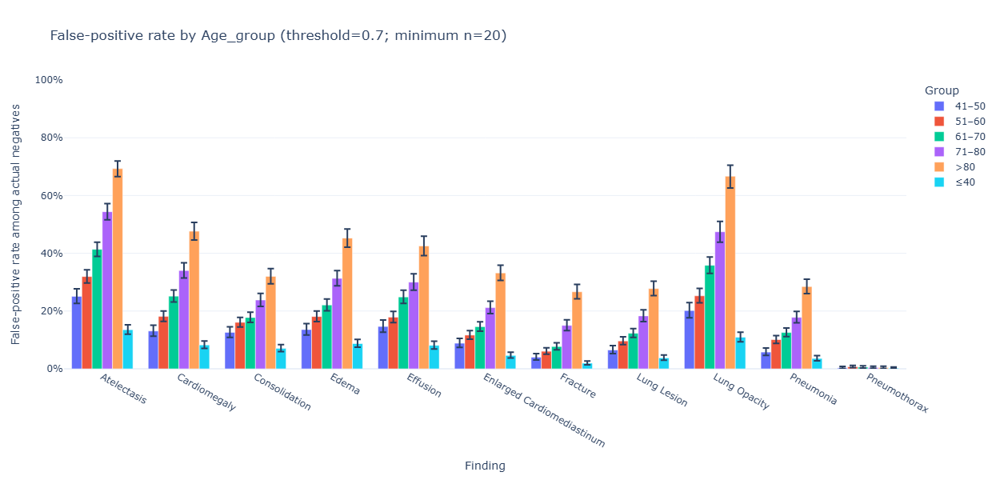
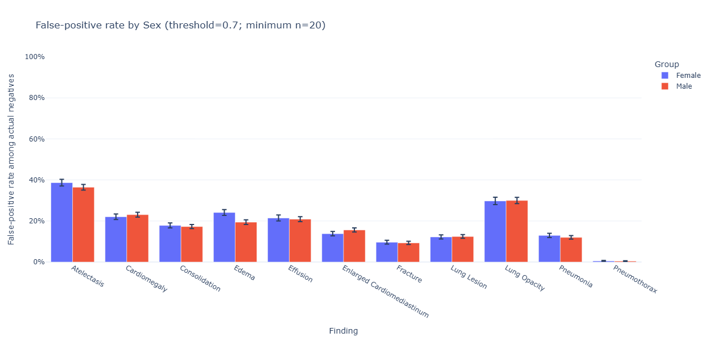
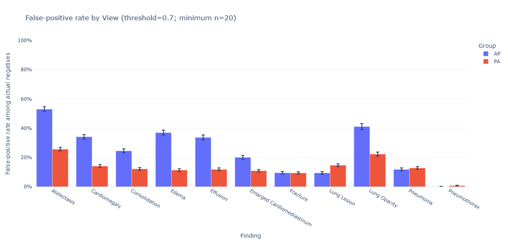

# AI Interaction 003 — Analysis of the first research question output

**Context**

# 1. Prompt

We formulated the question: Are false positives disproportionately associated with particular patient or image characteristics, especially AP/PA view, age and sex?

in the images we show the result of the experiment. Pls provide an analysis and interpretation. are there any furhter investigations or questions we should ask?

# 2. AI Response

## Summary of the important text parts

[Complete AI Response](./03_r1_analysis_output.md)

## 3. What we did

