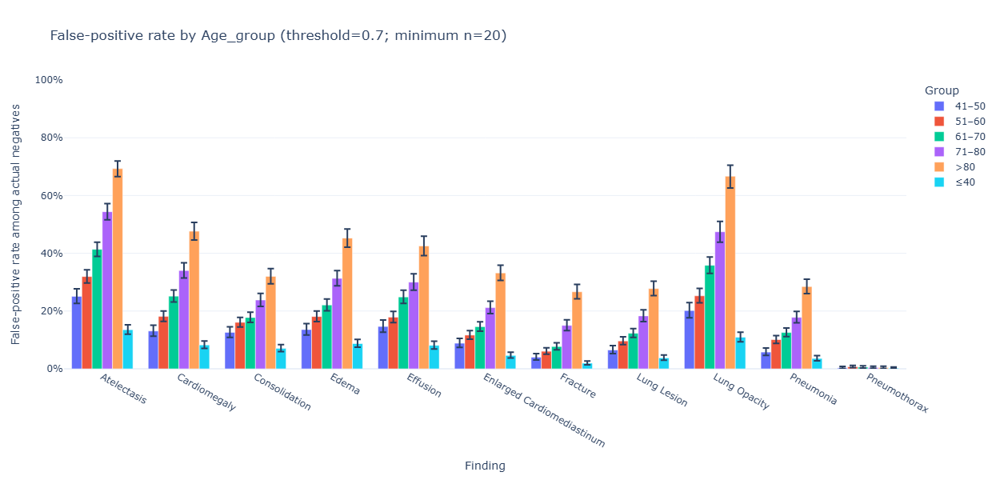
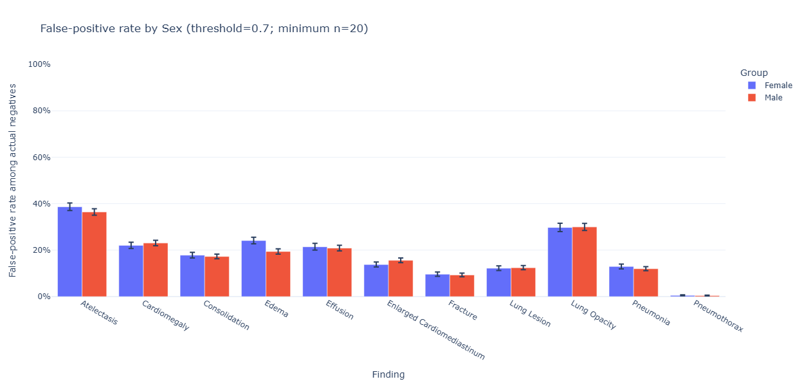
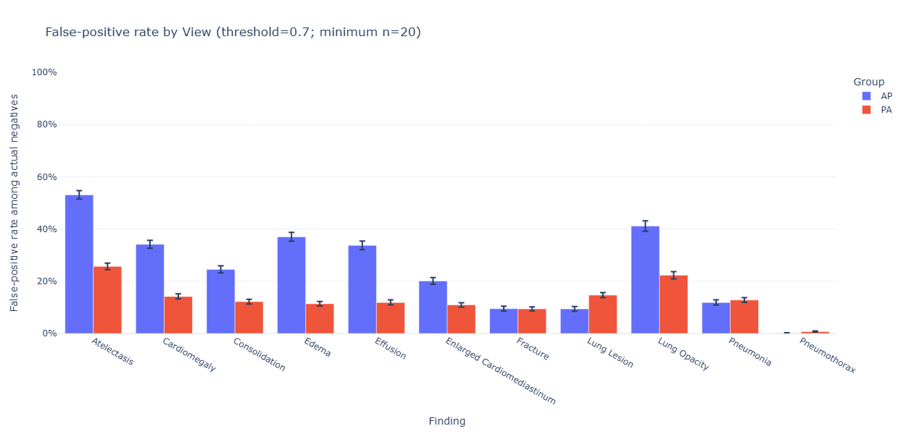

# AI Interaction 003 — Analysis of the second research question output

**Context**

# 1. Prompt

We formulated the question: Are false positives disproportionately associated with particular patient or image characteristics, especially AP/PA view, age and sex?

In the images we show the result of the experiment. Pls provide an analysis and interpretation. Are there any further investigations or questions we should ask?

# 2. AI Response

## Summary of the important text parts

**Main finding: AP/PA view is the strongest signal**
The view plot is probably your most interesting result.

For many findings, the false-positive rate is much higher for AP than PA:

...

This suggests that image acquisition/view may be an important source of model error.

However, you should not yet conclude that AP itself causes the false positives.

...

**Age is also a very strong pattern**

The particularly strong ones appear to be atelectasis and lung opacity, with older groups reaching roughly 60–70%.
Interpretation

...

Older patients may have different:
- image acquisition characteristics,
- prevalence of chronic anatomical changes,
- image quality,
- positioning,
- devices/tubes,
- comorbidities,
- combinations of findings.
So an important question becomes:

**Is age independently associated with false positives, or is age acting as a proxy for the types of images that older patients tend to receive?**

This is actually a very good next research question.

...

**Sex appears comparatively unimportant**

The sex plot is almost the opposite story.

Female and male FPRs are generally very close.

For example:
- Atelectasis: ~39% vs ~36%
- Cardiomegaly: ~22% vs ~23%
- Consolidation: ~18% vs ~17%
- Edema: ~24% vs ~19%
- Effusion: ~22% vs ~21%
- Enlarged cardiomediastinum: ~14% vs ~15%
- Fracture: ~10% vs ~9%
- Lung lesion: ~12% vs ~13%
- Lung opacity: ~30% vs ~30%
- Pneumonia: ~13% vs ~12%

Interpretation
At least from these plots:
Sex does not appear to be a major driver of false-positive behavior at the chosen threshold.

...

**The really interesting question: age × view**
I think this should be your next major investigation.

Right now you have:

Age → FPR

and

View → FPR

But those variables may interact.

For example, perhaps:
Older + AP → extremely high FPR

while
Older + PA → only moderately high FPR.

Or perhaps AP increases FPR equally at every age.

Those are very different explanations.
Make a heatmap
For each finding, create something like:
	PA	AP
≤40	FPR	FPR
41–50	FPR	FPR
51–60	FPR	FPR
61–70	FPR	FPR
71–80	FPR	FPR
>80	FPR	FPR

This could immediately reveal whether the effects are:
- additive → age and view independently affect FPR
- interactive → AP particularly hurts certain age groups
- confounded → the apparent age effect largely disappears after separating AP and PA
I would consider this one of the highest-value next visualizations.

[Complete AI Response](./03_r1_analysis_output.md)

## 3. What we did

