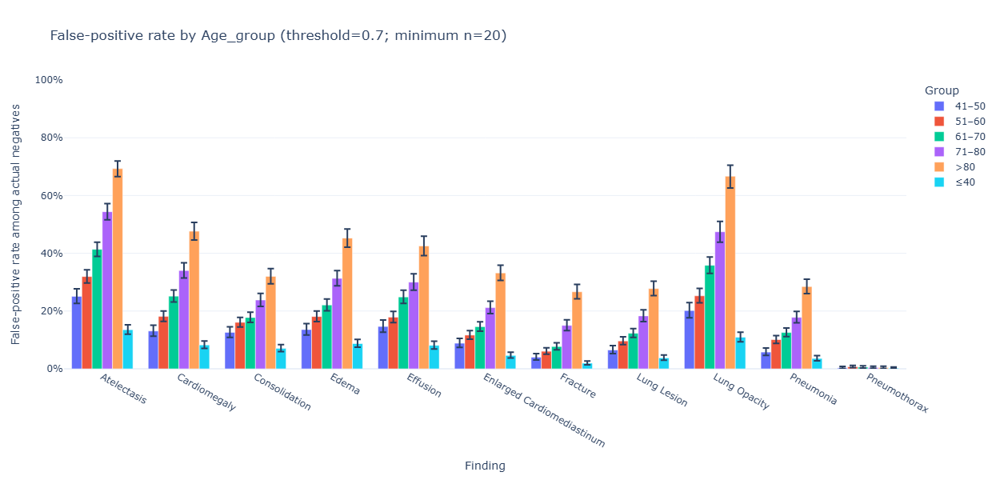
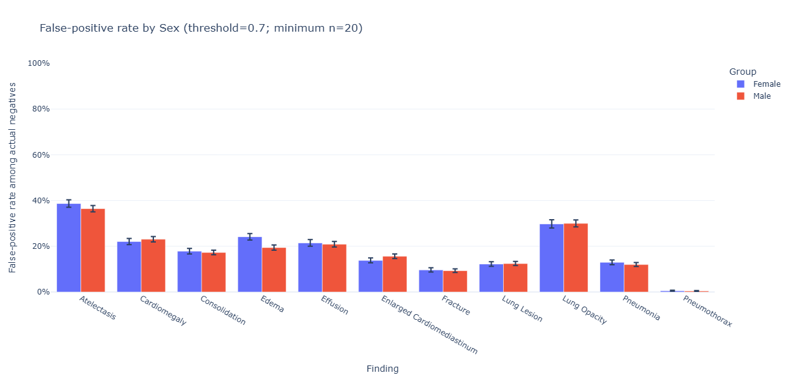
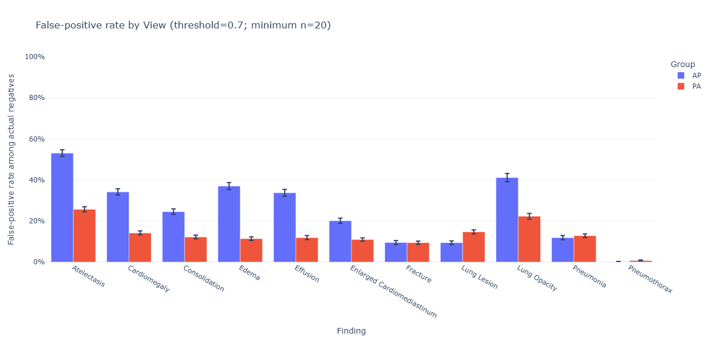

# AI Interaction 005 — Analysis of the third research question output

**Are false positives disproportionately associated with particular patient or image characteristics, especially AP/PA view, age and sex?**

# 1. Prompt

We formulated the question: Are false positives disproportionately associated with particular patient or image characteristics, especially AP/PA view, age and sex?

In the images we show the result of the experiment. Pls provide an analysis and interpretation. Are there any further investigations or questions we should ask?

# 2. AI Response

1. The AI suggests that AP/PA has the strongest signal.
2. Age also has a very strong pattern.
3. Sex appears comparatively unimportant
4. The AI suggests to create a heatmap showing age x view.

[Complete AI Response](./05b_r3_analysis_output.md)

## 3. What we did

The interpretation of the AI were correct and the plots showd that age and view have a strong impact on the model's errors.
We continued with the heatmap to get more insights between age x view. However, at some point the AI suggested to do Linear Regression tasks instead, so we stopped here.