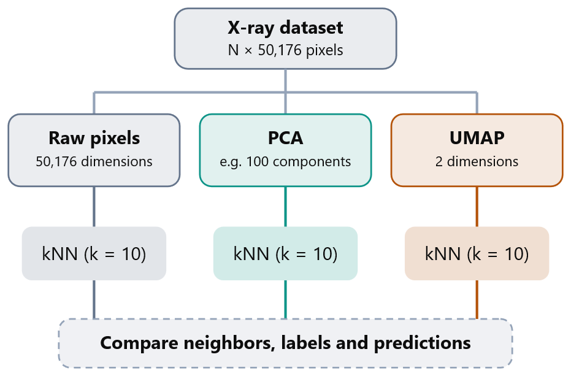
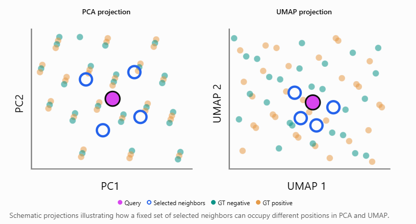

# AI Interaction — Ideas for NN

**Are the model's predictions locally consistent among visually similar X-ray images, and does this consistency differ between correctly and incorrectly classified samples?**

# 1. Prompt
[context: python code of implementation]
I'd like to enhance my knn visualization and compare it to findings with downprojections vs raw img data. Would that make sense? What would your suggestion be? And how could I visualize differences?

# 2. AI Response
Yes, that makes a lot of sense, especially for your Phase I model-behavior analysis of chest X-rays.

I would actually recommend extending your existing kNN analysis rather than replacing it with dimensionality reduction.

The interesting research question is:

How does dimensionality reduction affect which X-ray images are considered similar, and what can differences between those neighborhoods tell us about the model's predictions?

You already have a useful baseline: kNN using Euclidean distances between flattened raw images, with ground-truth labels, prediction scores, and TP/FP/FN/TN classifications.

I suggest comparing three representations:
1. Raw pixels + kNN — your current baseline.
2. PCA + kNN — tests how neighborhoods change after retaining only dominant image variation.
3. UMAP + kNN — explores whether a nonlinear low-dimensional representation produces different neighborhoods.
However, there is an important distinction: PCA is suitable for testing dimensionality reduction, while UMAP is more naturally suited to visualization and neighborhood exploration. Both can be compared, but their results need different interpretations.

**1. Suggested experimental design**

Keep the experimental conditions fixed: same dataset, same query indices, same preprocessing, same number of neighbors, and ideally the same distance metric.

For PCA, I would start with 50–100 components, depending on the explained variance. For UMAP, I'd begin with a 2D embedding for visualization, but avoid treating it as a faithful replacement for the original pixel-space metric.

One important point for Phase I: do not use the ground-truth labels or model predictions when constructing the PCA/UMAP representations. Use them only afterward to color points and evaluate neighborhoods. This preserves the unsupervised nature of the analysis.

Keep the experimental conditions fixed: same dataset, same query indices, same preprocessing, same number of neighbors, and ideally the same distance metric.

For PCA, I would start with 50–100 components, depending on the explained variance. For UMAP, I'd begin with a 2D embedding for visualization, but avoid treating it as a faithful replacement for the original pixel-space metric.

One important point for Phase I: do not use the ground-truth labels or model predictions when constructing the PCA/UMAP representations. Use them only afterward to color points and evaluate neighborhoods. This preserves the unsupervised nature of the analysis.

**2. How I would visualize the differences**
I'd create three complementary visualizations. Each answers a different question.

### Visualization A: Side-by-side nearest-neighbor grids

| Raw pixels | Classification | PCA | Classification | UMAP | Classification |
|------------|----------------|-----|----------------|------|----------------|
| #1 ✓       | TN             | #1 ✓ | TN            | #4 ✓ | TN            |
| #4 ✓       | TN             | #4 ✓ | TN            | #8   | TN            |
| #7         | FP             | #8   | TN            | #20  | TP            |
| #9         | TN             | #11  | FP            | #21  | FP            |
| #12        | TP             | #15  | FN            | #22  | FP            |

This would directly extend your existing 2×6 image grid. For a selected query image, show the ten nearest X-rays using each representation, including the classification, GT, and prediction score.

I'd also highlight images appearing in more than one neighborhood. This reveals whether PCA and UMAP preserve the same neighbors as raw-pixel kNN.

What you could investigate: Do false positives remain surrounded by similar X-rays across representations? Are the observed similarities stable, or are they dependent on your chosen representation?

### Visualization B: Compare neighborhoods quantitatively
I'd start with these metrics:
Metric	What it measures
Neighbor overlap@10	Fraction of raw-pixel neighbors also found by PCA/UMAP
Label agreement@10	Fraction of neighbors sharing the query's ground-truth label
Prediction score difference	Mean absolute difference between neighbor and query scores
TP/FP/FN/TN composition	Distribution of classification outcomes within each neighborhood

For example, if raw-pixel kNN returns the set $N_{\text{raw}}(q)$ and PCA returns $N_{\text{PCA}}(q)$, calculate:

$$
\operatorname{Overlap@10}(q) =
\frac{|N_{\text{raw}}(q) \cap N_{\text{PCA}}(q)|}{10}
$$

A value of 0.8 means that eight of the ten nearest neighbors are identical.

You can compute this over many queries and compare the average overlap across methods.

Since you already categorize images into TP, FP, TN, and FN for Pneumothorax, I would also calculate these metrics separately for each classification group.

For example, you might find that neighborhoods around false negatives are less stable than those around true positives.

### Visualization C: 2D projection with highlighted neighborhoods
This is where UMAP and PCA become especially interesting.

This would be my favorite visualization to complement the image grids.

For the same query, plot the dataset using PCA and UMAP, color points by ground-truth label, and highlight:
- The query image.
- Its ten nearest neighbors in raw-pixel space, regardless of where they appear in the projection.
- Optionally, its ten nearest neighbors according to the projected coordinates, using a different outline.
That last distinction matters. It lets you separate two questions: Where do original-space neighbors land in the projection? and Which neighbors would you retrieve if you performed kNN in the projection itself?

You could then recolor the plots by prediction score or TP/FP/FN/TN status to investigate model behavior.

**3. What I would prioritize for Phase I**

First: Raw vs PCA kNN

This is the clearest comparison. PCA gives you a controlled way to study how reduced dimensionality changes nearest neighbors. Record explained variance and neighborhood overlap.

Second: PCA and UMAP scatter plots

Visualize the images and highlight the neighbors retrieved in the original space. This helps investigate whether local structure survives the projection.

Third: UMAP kNN as an additional experiment

Examine how the nonlinear projection changes neighbor selection. Use trustworthiness or original-space neighborhood overlap to assess preservation, rather than assuming visually compact clusters indicate true similarity.

One limitation is especially important for your X-ray project: raw pixel similarity, PCA similarity, and UMAP proximity do not automatically correspond to clinical similarity. They may be dominated by anatomy, positioning, exposure, or AP/PA acquisition differences.

And because you are not using internal features of the DenseNet model, these are input-space analyses, not analyses of the model's learned representation. You can compare the resulting neighborhoods against model predictions, but you cannot conclude directly that the model uses the same notion of similarity.

My overall suggestion: Build one reusable visualization that accepts a representation (Raw, PCA, or UMAP) and a query index. Then add neighborhood overlap and a pair of 2D scatter plots. That would give you a coherent experiment rather than three unrelated visualizations, and let you test whether your observations about false positives and false negatives are robust to the chosen representation.

# 3. What we did
We compared kNN using raw pixels, PCA (100 components), and UMAP (2D), all with Euclidean distance.
We extended our visualization to show the neighbors side by side, highlighted shared images, and added a heatmap for neighborhood overlap.
We also calculated prediction agreement for TP, FP, FN, and TN using k = 10, 30, and 100 to see if neighbors receive similar predictions.
We also tried the suggested 2D scatter plots, but decided to focus on comparing neighborhoods and predictions instead.