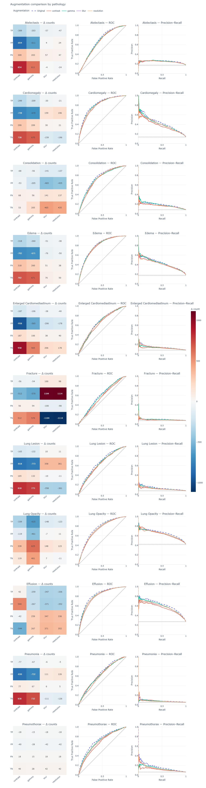

# AI Interaction — Analysis of augmentation output

**How sensitive does the model respond to certain data augmentations?**

# 1. Prompt

We have processed the data augmentation and gathered the models performance on each pathology depending on the augmentation. These are the resulting AUC and ROC curves, please interpret them

# 2. AI Response
Interpretation of ROC and AUC under data augmentation
The main finding is that data augmentation substantially changes classification outcomes at the fixed threshold, while ROC and Precision–Recall curves remain largely unchanged.

This suggests that augmentations primarily affect the model's prediction scores and classification threshold behavior, rather than fundamentally changing its ability to discriminate between positive and negative cases.

### 1. ROC curves: Discrimination remains largely stable
Across almost all pathologies, the ROC curves for the original and augmented images are very similar.
- Atelectasis, Cardiomegaly, Edema, and Consolidation: The ROC curves nearly overlap, suggesting minimal changes in discrimination.
- Lung Opacity and Effusion: Small differences are visible, with the original model generally performing slightly better across portions of the ROC curve.
- Pneumothorax: Differences are somewhat more noticeable, particularly at lower false-positive rates, but the overall curves remain similar.
- Fracture: The curves are close to the diagonal, indicating comparatively weak discrimination, with only modest differences between augmentations.
Although numerical AUC values are not displayed, the substantial overlap suggests that ROC-AUC changes are generally small.

### 2. Precision–Recall curves: Similar overall performance
The PR curves also remain relatively stable across augmentations.

However, some differences are visible:
- Effusion: The original images generally achieve higher precision across much of the recall range.
- Lung Opacity: The original images show a slight advantage, especially at intermediate recall.
- Pneumothorax: The original images show noticeably higher precision across parts of the curve, although precision is relatively low overall.
- Cardiomegaly and Edema: Differences are minor.
PR-AUC may therefore show somewhat more sensitivity to augmentation for certain pathologies, particularly Pneumothorax and Effusion.

Importantly, PR curves are especially informative for less prevalent diseases, where ROC-AUC can appear reasonably good despite many false-positive predictions.

### 3. Why do classification counts change so dramatically?
This is the most interesting observation.

For example, the heatmaps show substantial changes in TP, FP, FN, and TN counts for several pathologies, while their ROC curves barely change.

This is not necessarily contradictory.

ROC-AUC measures ranking ability, whereas the confusion matrix measures classification at one specific threshold.

An augmentation can systematically shift prediction scores downward without substantially changing the relative ranking of samples.

For example:
Illustrative example — threshold = 0.7
Sample	Original	Augmented
Positive A	0.85 (TP)	0.65 (FN)
Negative B	0.75 (FP)	0.55 (TN)

Both scores decrease by 0.20. The ranking remains unchanged, so ROC-AUC is identical, but both classifications change.

This is consistent with the substantial reductions in positive predictions visible in your heatmaps, particularly under contrast and gamma augmentation.

### 4. What does this reveal about model behavior?
Your results suggest three important characteristics.

1. Ranking robustness: The model generally preserves its ability to rank positive cases above negative cases after augmentation.

2. Threshold sensitivity: Despite stable ranking performance, some augmentations cause substantial changes in binary predictions. This indicates that classification results can be sensitive to score shifts around the decision threshold.

3. Pathology-dependent effects: The magnitude and direction of these changes differ considerably between pathologies. Therefore, robustness cannot necessarily be generalized across diseases.

One important qualification: Similar ROC-AUC values do not establish that the model ranks individual samples identically. They only indicate similar aggregate discrimination. A paired ranking or score analysis would be needed to confirm rank preservation.

My main conclusion: Your findings provide evidence of discrimination robustness, but not necessarily prediction stability under data augmentation.

For a stronger quantitative interpretation, I would calculate the change in ROC-AUC and Average Precision (AP) for each pathology and augmentation. This would help distinguish genuinely negligible differences from the small but visible changes in the curves.

# 3. What we did
We used the AI explanation to better understand why classification counts change a lot while ROC and PR curves remain similar.
We adjusted our interpretation and concluded that the model generally keeps its discriminative ability, even though prediction scores change.
We also noticed that the effects differ across pathologies and augmentations.
We used the AI interpretation as guidance but checked it against our visualizations.