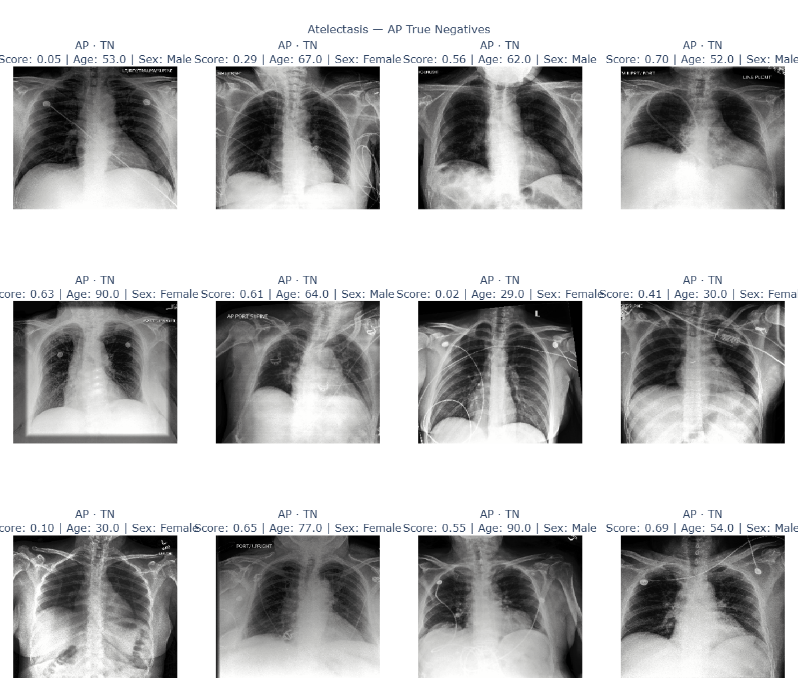
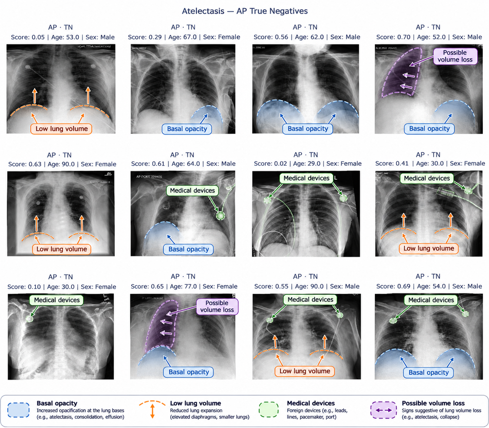

# AI Interaction 009 — Annotate xray images

**Context:** The AI often asked us to look and compare certain images, e.g. images in the false positive group. As we are no experts in xray images so we tried to ask the AI to annotate some pictures.

# 1. Prompt

Can you annotate the xray images with the following: Basal opacity,Low lung volume, Medical devices, Possible volume loss?

# 2. AI Response

## 3. What we did

While the AI was able to recover some certain findings like medical devices, we were unsure about other pathologies. As we are not experts in xray images, we were not confident enough to trust the AI provided annotations.